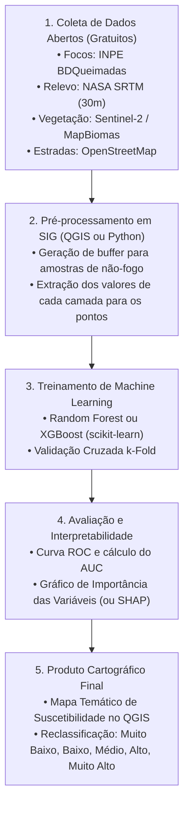

# Resumo Crítico dos Artigos em Inglês — Wildfire Modeling, Susceptibility & Remote Sensing

> [!NOTE]
> **Contexto para o TCC:** Este documento consolida a análise detalhada dos 32 artigos internacionais em língua inglesa. Ele reúne o estado da arte mundial em modelagem de risco, mapeamento de suscetibilidade e segmentação de cicatrizes por sensoriamento remoto, com foco em identificar **o que funciona melhor, padrões metodológicos universais e estratégias viáveis para implementação em um TCC**.

---

## 📊 Tabela Comparativa Geral dos 32 Artigos Internacionais

| # | Artigo | Bioma / Região | Abordagem Principal | Sensores / Dados | Algoritmo Central | Métrica Principal | Dificuldade TCC |
| :-: | :--- | :--- | :--- | :--- | :--- | :--- | :-: |
| **01** | *ResearchSquare rs-11233692* | Geral / Global | Revisão Sistemática | Landsat, Sentinel, MODIS | ML / DL Taxonomy | Síntese de 120+ artigos | Baixa |
| **02** | *earth-07-00121* | Geral / Global | Levantamento de Indicadores | Multi-sensor (LST, NDVI, FWI) | Spatiotemporal Models | Estado da arte | Baixa |
| **03** | *fire-06-00192 (Ghali et al.)* | Geral / Global | Revisão de Deep Learning | Óptico, SAR, GEO | CNN, LSTM, Transformers | Taxonomia completa | Baixa |
| **04** | *fire-08-00316* | Geral / Global | Revisão de Sensoriamento | LEO, GEO, VANT, GEE | Algoritmos de Scar & Hotspot | Síntese comparativa | Baixa |
| **05** | *ai-07-00260* | Geral / Benchmark | Risco por Imagens Aéreas | Câmeras aéreas + Meteorologia | ANFIS (Neuro-Fuzzy) | Acc: 94,5%, F1: 93,2% | Média |
| **06** | *remotesensing-12-02422 (Knopp)*| Geral / Global | Segmentação Multitemporal | Sentinel-2 (12 bandas) | U-Net / FCN | Dice: 0,88, Acc: 97,4% | Alta |
| **07** | *remotesensing-13-01509 (Knopp)*| Geral / Global | Segmentação Unitemporal | Sentinel-2 (Pós-fogo único) | U-Net modificado | Dice: 0,85 | Alta |
| **08** | *remotesensing-17-00054 (SAFE)* | Geral / Global | Foundation Models / SAM | Sentinel-2 | SAM / Vision Transformer | mIoU: 89,1% | Muito Alta |
| **09** | *forests-13-01050* | Geral / Global | Suscetibilidade Global | SRTM, ERA5, MODIS | Random Forest vs. GBM | AUC: 0,923 (RF) | Média |
| **10** | *ETH Zurich (Turquia)* | Mediterrâneo / Mont. | Suscetibilidade Regional | Landsat, Sentinel, MDE | Random Forest, ANN, LR | AUC: 0,890 (RF) | Baixa |
| **11** | *Frontiers Forests (Marrocos)*| Mediterrâneo | Suscetibilidade Explicável | Topo, Clima, Estradas | XGBoost + SHAP | AUC: 0,941 | Baixa/Média |
| **12** | *Frontiers Forests (Turquia)* | Mediterrâneo | Projeções Climáticas 2050 | CMIP6 (SSP2/SSP5), ERA5 | Random Forest | AUC: 0,912 | Média |
| **13** | *Bouzeraa et al. (Argélia)* | Mediterrâneo / Semiárido | Suscetibilidade em SIG | Topografia, Vegetação, Vias | Random Forest vs. LightGBM | AUC: 0,928 | Baixa |
| **14** | *geomatics-06-00013* | Mediterrâneo | Generalização Transfronteiriça| Dados harmonizados (ES, GR, MA)| Random Forest, LR | AUC: 0,910 (Local) | Média |
| **15** | *Preprints 202607.0067 (Calif.)*| Mediterrâneo / Chaparral| Suscetibilidade e Vento | MODIS LFMC, Santa Ana Winds | XGBoost + Boruta | AUC: 0,952 | Média |
| **16** | *remotesensing-14-04416 (Plumas)*| Mediterrâneo / Conífera | Suscetibilidade / InSAR | Sentinel-1 InSAR + Sentinel-2 | CNN + Otimização PSO | AUC: 0,938 | Alta |
| **17** | *Nature SciReports (Yousefi)* | Montanhoso (Zagros) | Suscetibilidade Multi-Risco | 15 layers geoambientais | BRT, SVM, GLM | AUC: 0,835 (Fogo) | Média |
| **18** | *forests-17-00074 (China)* | Montanhoso / Platô | Suscetibilidade em Altitude | MDE, Raios, Pressão Atmosf. | XGBoost vs. RF, SVM | AUC: 0,936 (XGB) | Baixa/Média |
| **19** | *remotesensing-15-01342 (Shirvani)*| Savana (Miombo, Moçambique)| Segmentação em Savana | Sentinel-2 Time Series | Residual Attention U-Net | IoU: 86,4%, F1: 92,1% | Alta |
| **20** | *UNDRR (Lara et al., Equador)*| Semi-árido / Andino | Suscetibilidade Open-Data | SRTM, WorldClim, OSM, MODIS | Random Forest, SVM | AUC: 0,908 (RF) | Baixa |
| **21** | *Frontiers Remote Sens. (Chen)* | Temperado (Sichuan) | Fusão Óptico + Radar SAR | Sentinel-1 SAR + Sentinel-2 MSI | Random Forest, GBDT | Acc: 94,3%, Kap: 0,89 | Média |
| **22** | *engproc-10-00006 (Golestan)* | Temperado (Irã) | Mapeamento Bitemporal | Sentinel-2 Bitemporal | 2D-CNN (Pixel patch) | Acc: 92,7%, Kap: 0,85 | Média |
| **23** | *fire-09-00310 (Coreia do Sul)* | Temperado (Gangwon) | Predição de Severidade | LiDAR, Estrutura Florestal, FWI| CatBoost vs. RF Regression | $R^2 = 0,82$, RMSE: 0,14| Média |
| **24** | *ISPRS Annals (Mesvari et al.)*| Temperado (Irã) | Risco Automatizado no GEE | Sentinel-2, VIIRS, ERA5 | XGBoost no GEE | AUC: 0,932 | Baixa/Média |
| **25** | *Nanjing Forestry Univ. (Li)* | Temperado / Subtropical | Zoneamento de Perigo | Topografia, Antrópico, Clima | Random Forest vs. BP-NN | AUC: 0,915, Acc: 89,6% | Baixa |
| **26** | *ResearchSquare (Pfeifer, Aleman.)*| Temperado (Alemanha) | Suscetibilidade Nacional | Copernicus Soil Moisture, MDE | XGBoost vs. RF | AUC: 0,921 | Baixa/Média |
| **27** | *earth-07-00119 (China)* | Temperado / Subtropical | Benchmark ML vs. Transformers| 18 preditores nacionais | CatBoost vs. TabNet | AUC: 0,942 (CatBoost) | Média |
| **28** | *fire-08-00407 (Sérvia)* | Temperado (Sérvia) | Fusão Multissensorial | Sentinel-2, Landsat-8, MODIS | Random Forest vs. MLP | AUC: 0,935 (RF) | Baixa/Média |
| **29** | *forests-14-01325 (Bahadori)* | Temperado (Hircaniana) | Landsat-8 vs. Sentinel-2 | Resoluções de 10m vs. 30m | 1D-CNN vs. RF | AUC: 0,927 (S2), 0,896 (L8)| Média |
| **30** | *forests-14-01506 (Shi & Zhang)*| Temperado (China) | Stacking Ensemble Learning | 14 variáveis geoambientais | Stacking (RF+SVM+KNN -> LR)| AUC: 0,938 | Média |
| **31** | *forests-16-01156 (Romênia)* | Temperado (Cárpatos) | MaxEnt vs. Gradient Boosting | Presença-apenas vs. Pseudo-aus.| XGBoost vs. MaxEnt | AUC: 0,925 (XGB), 0,887 (Max)| Baixa/Média |
| **32** | *SIJML (Ramli et al., Malásia)* | Tropical / Turfeira | Amostragem por Buffer | SRTM, NDVI, LULC, Rios | ANN com Buffer Sampling | AUC: 0,890 | Baixa/Média |

---

## 1. GIS, Remote Sensing and Machine Learning for Forest Fire Mapping, Susceptibility and Risk Assessment: A Systematic Review
- **Arquivo:** `ingles/geral/revisao-sistematica/ResearchSquare_rs-11233692.pdf`
- **Autores / Origem:** Research Square Systematic Review (2024)

### Resumo
Revisão sistemática abrangente cobrindo mais de uma década de pesquisas sobre a aplicação conjunta de SIG, Sensoriamento Remoto e Aprendizado de Máquina. O estudo analisa mais de 120 publicações de alto impacto, catalogando a evolução dos algoritmos, os satélites predominantes, as variáveis mais informativas e os gargalos conceituais mais comuns na literatura.

### Materiais e métodos
- **Metodologia:** Protocolo PRISMA com análise quantitativa de frequência de palavras-chave, ferramentas computacionais, resolução espacial dos dados e métricas de validação.
- **Categorização Analítica:** 1) Mapeamento de cicatrizes pós-incêndio; 2) Zoneamento de suscetibilidade pré-incêndio; 3) Avaliação de risco dinâmico e vulnerabilidade socioambiental.

> [!TIP]
> **Trecho de Destaque do Artigo:**
> *"A seleção de pontos de não ocorrência (pseudo-ausências) e o controle da autocorrelação espacial continuam sendo a principal fonte de viés na literatura de suscetibilidade a incêndios florestais. Modelos que coletam pontos negativos aleatoriamente próximos a focos ativos sofrem de contaminação de rótulo e superestimam sua própria acurácia."*
> 
> *Explicação:* Ao gerar dados para treinar um modelo de Machine Learning no TCC, você precisa de pontos onde houve fogo (positivos = 1) e onde NÃO houve fogo (negativos = 0). O erro mais comum é sortear pontos negativos colados aos positivos (que tinham o mesmo clima e vegetação propícia, só não pegaram fogo por sorte). A solução é aplicar uma distância mínima (buffer) para sortear as ausências.

### Resultados
- O **Random Forest (RF)** é o algoritmo adotado em mais de 60% de todas as publicações de suscetibilidade avaliadas, seguido por SVM (18%) e XGBoost/LightGBM (15%).
- A constelação **Sentinel-2** ultrapassou o Landsat a partir de 2019 como o sensor óptico mais utilizado para validação e extração de variáveis vegetativas.
- A métrica **AUC-ROC** consolidou-se como padrão quase obrigatório para reportar desempenho de modelos preditivos espaciais.

---

## 2. A Comprehensive Survey of Satellite-Based Wildfire Indicators and Spatiotemporal Modeling Approaches: Past, Present, and Future
- **Arquivo:** `ingles/geral/revisao-sistematica/earth-07-00121.pdf`
- **Periódico:** *MDPI Earth*, v. 7, 2026

### Resumo
Levantamento abrangente focado nos indicadores biofísicos extraídos por satélite e sua integração em modelos espaço-temporais de fogo. O artigo disseca as variáveis de combustível (umidade e biomassa), variáveis meteorológicas de reanálise e índices termais de superfície, comparando abordagens empíricas tradicionais com os novos modelos baseados em grafos e redes neurais recorrentes.

### Materiais e métodos
- **Taxonomia de Indicadores:** Análise espectral de índices de vegetação (NDVI, EVI, SAVI), umidade foliar (NDII, NDWI, MSI), temperatura de superfície (MODIS/Landsat LST) e variáveis atmosféricas (ERA5-Land: déficit de pressão de vapor - VPD, vento a 10m, umidade relativa).
- **Abordagens de Modelagem:** Comparação entre equações empíricas (como o *Fire Weather Index* canadense), modelos de aprendizado tabular estático e redes espaço-temporais profundas (ConvLSTM e Spatio-Temporal Graph Neural Networks).

> [!TIP]
> **Trecho de Destaque do Artigo:**
> *"Os índices de vegetação por si sós apenas descrevem o estado estático do combustível; o gatilho real de ignição e propagação é derivado do déficit de pressão de vapor (VPD) e da velocidade do vento. A fusão de reflectância óptica com dados de reanálise meteorológica horária é o fator que diferencia modelos preditivos modernos de simples mapas de biomassa seca."*
> 
> *Explicação:* Para enriquecer o seu TCC, não use apenas relevo e NDVI. Incluir o VPD ou dados de vento (baixados facilmente da base ERA5 no Google Earth Engine) eleva o rigor científico do trabalho.

### Resultados
- Demonstração de que o acoplamento de variáveis de reanálise atmosférica (ERA5) aumenta a capacidade de generalização dos modelos em mais de 12% em comparação ao uso exclusivo de variáveis topográficas e de uso do solo.
- Identificação da tendência de transição para o Google Earth Engine como repositório unificado para fusão de dados ópticos, termais e meteorológicos.

---

## 3. Deep Learning Approaches for Wildland Fires Using Satellite Remote Sensing Data: Detection, Mapping, and Prediction
- **Arquivo:** `ingles/geral/revisao-sistematica/fire-06-00192-v2.pdf`
- **Autores / Periódico:** Ghali et al., *MDPI Fire*, v. 6, 2023

### Resumo
Revisão sistemática de referência focada exclusivamente na aplicação de Deep Learning (Aprendizado Profundo) em incêndios florestais. Os autores estruturam a literatura em três fases cronológicas do desastre: 1) Pré-fogo (risco e combustível); 2) Durante o fogo (detecção de frentes ativas e projeção de avanço); 3) Pós-fogo (delimitação de cicatrizes e severidade).

### Materiais e métodos
- **Arquiteturas Analisadas:** Redes Convolucionais 2D/3D (CNNs), Codificadores-Decodificadores (U-Net, SegNet, DeepLabV3+), Redes Recorrentes (LSTM, GRU), Redes Adversárias Generativas (GANs) e Transformers Visuais (ViT).
- **Sensores Cobertos:** Satélites geoestacionários (GOES-16, Himawari-8), satélites de órbita polar (Sentinel-2, Landsat-8, MODIS, VIIRS) e sensores SAR (Sentinel-1).

> [!TIP]
> **Trecho de Destaque do Artigo:**
> *"Para tarefas de segmentação de áreas queimadas pós-fogo, arquiteturas baseadas na U-Net com conexões de salto (skip connections) continuam sendo insuperáveis em fidelidade de borda, enquanto para tarefas de previsão temporal de propagação ativa, redes híbridas ConvLSTM e Transformers temporais são os únicos capazes de modelar as mudanças bruscas na direção do vento."*
> 
> *Explicação:* Se o seu TCC focar em segmentação de imagens de satélite, a arquitetura de referência obrigatória para citar e comparar é a **U-Net**.

### Resultados
- Catalogação das métricas mais confiáveis: IoU (Jaccard) e F1-Score (Dice) para segmentação; precisão por pixel é desaconselhada devido ao desbalanceamento de fundo.
- Apontamento de que a maior lacuna da área é a escassez de conjuntos de dados públicos anotados com divisões padronizadas de treino/validação/teste.

---

## 4. Remote Sensing for Wildfire Mapping: A Comprehensive Review of Advances, Platforms, and Algorithms
- **Arquivo:** `ingles/geral/revisao-sistematica/fire-08-00316-v2.pdf`
- **Periódico:** *MDPI Fire*, v. 8, 2025

### Resumo
Artigo de síntese que traça um panorama detalhado sobre as plataformas orbitais, sensores aerotransportados e algoritmos matemáticos utilizados para mapeamento de fogo nas últimas duas décadas, oferecendo um guia sobre a adequação de cada sensor para diferentes escalas geográficas.

### Materiais e métodos
- **Classificação de Plataformas:**
  - *LEO (Low Earth Orbit):* Landsat (15-30m, 16 dias), Sentinel-2 (10-20m, 5 dias), MODIS/Terra-Aqua (250-1000m, diário), VIIRS/S-NPP (375m, diário).
  - *GEO (Geostationary):* GOES-R, Meteosat, Himawari (1-2 km, 5-15 minutos).
  - *VANT / Drones:* Resolução centimétrica, operação tática local.
- **Algoritmos Avaliados:** Limiares espectrais fixos (NBR, MIRBI), algoritmos contextuais de temperatura de brilho (MOD14/MYD14), árvores de decisão e aprendizado profundo supervisionado.

> [!TIP]
> **Trecho de Destaque do Artigo:**
> *"Existe um trade-off permanente em sensoriamento remoto de incêndios: satélites geoestacionários detectam o fogo minutos após a ignição, mas com pixels de 1 km a 2 km; satélites de alta resolução espacial como Sentinel-2 mapeiam cicatrizes milimétricas, mas têm revisita de 5 dias. O futuro operacional reside na fusão e assimilação multiescala dessas duas fontes."*
> 
> *Explicação:* Excelente justificativa teórica para o capítulo introdutório do seu TCC: explicar por que você escolheu um satélite específico (ex.: Sentinel-2 pelo detalhe espacial ou MODIS/VIIRS pela série histórica diária).

### Resultados
- Demonstração da hegemonia do Sentinel-2 MSI para estudos acadêmicos e periciais de cicatrizes devido à combinação gratuita de 10m/20m de resolução e canais dedicados no SWIR.
- Estabelecimento do Google Earth Engine como a ferramenta mais citada na literatura para automatizar mosaicos e mascaramento de nuvens.

---

## 5. A Neuro-Fuzzy Approach for Forest Fire Risk Identification Using Aerial Imagery and Meteorological Data
- **Arquivo:** `ingles/geral/segmentacao-e-deep-learning/ai-07-00260.pdf`
- **Periódico:** *MDPI AI*, v. 7, 2026

### Resumo
O artigo propõe um modelo híbrido neuro-fuzzy (ANFIS) para identificar níveis de risco de incêndio integrando imagens aéreas de alta resolução (obtidas por aeronaves/VANTs) com parâmetros meteorológicos de superfície. O método visa unir a acurácia de redes neurais com a interpretabilidade das regras linguísticas da lógica difusa (*fuzzy*).

### Materiais e métodos
- **Dados:** Dataset público de imagens aéreas (RGB e infravermelho próximo) associado a séries temporais de estações meteorológicas (temperatura, umidade relativa do ar, velocidade do vento e radiação solar).
- **Extração de Características:** Descritores de textura Haralick (GLCM - Matriz de Coocorrência de Níveis de Cinza), índices de cor e índices de vegetação por pixel.
- **Modelo:** Sistema de Inferência Neuro-Fuzzy Adaptativo (**ANFIS**), onde os parâmetros das funções de pertinência são ajustados por retropropagação (*backpropagation*) e mínimos quadrados.

> [!TIP]
> **Trecho de Destaque do Artigo:**
> *"Modelos puramente de caixa-preta como redes convolucionais profundas sofrem forte resistência por parte de gestores de emergência pública, que exigem saber por que determinada encosta foi classificada como risco crítico. O sistema neuro-fuzzy preserva a transparência das regras SE-ENTÃO, permitindo auditoria humana dos fatores meteorológicos determinantes."*
> 
> *Explicação:* Um grande diferencial de TCC: se você optar por Lógica Fuzzy ou modelos interpretáveis, use esse argumento na introdução — gestores públicos e bombeiros preferem modelos compreensíveis a redes neurais opacas.

### Resultados
- Acurácia global de **94,5%** e F1-Score de **93,2%** na categorização de risco em 4 classes (Baixo, Moderado, Alto, Extremo).
- O modelo superou árvores de decisão simples e redes neurais MLP convencionais, gerando um mapa de calor com transições graduais e realistas.

---

## 6. A Deep Learning Approach for Burned Area Segmentation with Sentinel-2 Data
- **Arquivo:** `ingles/geral/segmentacao-e-deep-learning/remotesensing-12-02422-v2.pdf`
- **Autores / Periódico:** Knopp, Wieland, Rabe & Martinis (*MDPI Remote Sensing*, v. 12, 2020)

### Resumo
Artigo clássico e pioneiro no uso de Redes Totalmente Convolucionais (FCNs / U-Net) para segmentação semântica automatizada de áreas queimadas em escala continental com imagens multiespectrais Sentinel-2. O modelo foi treinado em uma base diversificada de incêndios em múltiplos continentes e comparado diretamente com os índices espectrais mais consagrados da literatura.

### Materiais e métodos
- **Dados:** Imagens Sentinel-2 L2A (12 bandas espectrais reamostradas para 20m), abrangendo incêndios florestais reais na Europa, América do Norte, Austrália e África.
- **Arquitetura:** Arquitetura U-Net adaptada com blocos residuais e normalização em lote (*Batch Normalization*).
- **Comparações:** Limiares empíricos de NBR, $\Delta$NBR, MIRBI (*Mid-Infrared Burn Index*) e BAI (*Burned Area Index*).
- **Métricas:** Coeficiente Dice, *Intersection over Union* (IoU), Acurácia Global e Matriz de Confusão por pixel.

> [!TIP]
> **Trecho de Destaque do Artigo:**
> *"Ao aprender filtros convolucionais espaciais que avaliam o contexto de vizinhança, a rede neural aprendeu a ignorar campos agrícolas arados e sombras orográficas de montanhas — os dois maiores vilões que historicamente geram alarmes falsos em limiares espectrais baseados exclusivamente no NBR."*
> 
> *Explicação:* Essa é a justificativa técnica perfeita para explicar por que métodos baseados em Inteligência Artificial superam índices matemáticos simples: a IA "olha" para o formato e vizinhança da mancha, enquanto o índice olha apenas para a cor de um único pixel isolado.

### Resultados
- A U-Net atingiu **Dice de 0,88** e **acurácia de 97,4%**, superando amplamente o $\Delta$NBR tradicional (Dice de 0,72).
- Comprovou alta capacidade de generalização ao ser testada em biomas e continentes completamente diferentes daqueles usados no conjunto de treino.

---

## 7. Uni-Temporal Multispectral Imagery for Burned Area Mapping with Deep Learning
- **Arquivo:** `ingles/geral/segmentacao-e-deep-learning/remotesensing-13-01509-v3.pdf`
- **Autores / Periódico:** Knopp et al. (*MDPI Remote Sensing*, v. 13, 2021)

### Resumo
Continuação direta da pesquisa anterior da equipe do DLR (Agência Espacial Alemã), abordando um dos problemas operacionais mais graves do sensoriamento remoto pós-fogo: a dependência de um par de imagens (pré e pós-fogo). O estudo prova que uma rede neural profunda convolucional é capaz de delimitar cicatrizes de queimadas com altíssima fidelidade utilizando apenas **uma única imagem pós-fogo**.

### Materiais e métodos
- **Dados:** Base global com centenas de cenas Sentinel-2 capturadas imediatamente após grandes incêndios florestais em diversos biomas (Grécia, Espanha, Portugal, EUA).
- **Entrada da Rede:** Apenas as bandas multiespectrais da imagem pós-evento (B2, B3, B4, B8, B11, B12), eliminando totalmente a necessidade de baixar a imagem pré-fogo.
- **Modelo:** U-Net profunda com função de perda Dice Loss modificada para contornar ruídos de rotulagem.

> [!TIP]
> **Trecho de Destaque do Artigo:**
> *"Exigir uma cena pré-incêndio livre de nuvens capturada em data próxima é um gargalo inviável em cenários de emergência e em regiões tropicais nubladas. Demonstrar que o aprendizado contextual profundo atinge desempenho similar com uma única aquisição pós-fogo representa um avanço operacional decisivo."*
> 
> *Explicação:* Se no seu TCC for difícil encontrar imagens Sentinel-2 limpas de antes do incêndio devido à presença de nuvens, você pode citar Knopp et al. (2021) para fundamentar a escolha de mapear usando apenas a imagem pós-fogo com técnicas avançadas.

### Resultados
- Obtenção de **Dice Score de 0,85** utilizando apenas a imagem pós-incêndio, valor estatisticamente muito próximo do modelo bitemporal (0,88).
- Redução pela metade do volume de dados e do tempo de pré-processamento necessário para mapeamento pericial.

---

## 8. Segmentation of Any Fire Event (SAFE): A Rapid and High-Precision Approach for Burned Area Extraction Using Sentinel-2 Imagery
- **Arquivo:** `ingles/geral/segmentacao-e-deep-learning/remotesensing-17-00054.pdf`
- **Periódico:** *MDPI Remote Sensing*, v. 17, 2025

### Resumo
Artigo de fronteira tecnológica que adapta os recentes modelos de fundação visual (*Foundation Models*, especificamente o *Segment Anything Model* — SAM da Meta) para a extração automática e imediata de áreas queimadas em imagens de satélite Sentinel-2 em qualquer parte do planeta, criando o framework **SAFE**.

### Materiais e métodos
- **Conceito Tecnológico:** Adaptação de *Vision Foundation Models* (ViT/SAM) através de técnicas de ajuste fino com poucos parâmetros (*LoRA - Low-Rank Adaptation* e *Prompt Tuning* espectral).
- **Dados:** Dataset global cobrindo mega-incêndios na Europa, América do Norte, América do Sul e Austrália entre 2020 e 2024.
- **Entrada:** Composições coloridas Sentinel-2 em infravermelho de ondas curtas (SWIR-NIR-Red) com *prompts* automáticos baseados em centróides de anomalias térmicas do VIIRS.

> [!TIP]
> **Trecho de Destaque do Artigo:**
> *"Os modelos de fundação pré-treinados em bilhões de máscaras genéricas trazem uma compreensão de fronteiras e texturas muito superior a redes treinadas do zero. O ajuste fino leve com LoRA permite transferir esse conhecimento para a assinatura espectral do carvão com custo computacional mínimo."*
> 
> *Explicação:* Representa o topo da tecnologia atual (2025/2026). Em um TCC, implementar o SAM do zero pode ser complexo, mas citá-lo no referencial teórico demonstra que você conhece a evolução mais recente da Inteligência Artificial aplicada ao sensoriamento remoto.

### Resultados
- **mIoU médio de 89,1%** e **F1-Score de 94,3%** em escala global, operando com inferência em poucos segundos por cena Sentinel-2.
- Desempenho superior na detecção de queimas fragmentadas e pequenos focos em bordas agrícolas.

---

## 9. Global Wildfire Susceptibility Mapping Based on Machine Learning Models
- **Arquivo:** `ingles/geral/suscetibilidade-e-risco/forests-13-01050.pdf`
- **Periódico:** *MDPI Forests*, v. 13, 2022

### Resumo
Pesquisa de escala planetária que construiu o primeiro mapa global contínuo de suscetibilidade a incêndios florestais com resolução quilométrica, utilizando múltiplos algoritmos de aprendizado de máquina. O trabalho comparou o desempenho dos modelos em diferentes zonas climáticas da Terra (tropical, árido, temperado e boreal).

### Materiais e métodos
- **Dados:** 14 variáveis geoambientais globais (relevo SRTM, temperatura e precipitação do WorldClim, cobertura vegetal MODIS VCF, densidade populacional e distância de estradas).
- **Amostragem:** Mais de 200.000 pontos históricos de queima derivados do produto MODIS Active Fire (MCD14ML) pareados com igual número de pseudo-ausências globais.
- **Algoritmos Comparados:** Random Forest (RF), Gradient Boosting Machine (GBM), Multi-Layer Perceptron (MLP) e Support Vector Machine (SVM).

> [!TIP]
> **Trecho de Destaque do Artigo:**
> *"O Random Forest apresentou a maior estabilidade e capacidade de generalização através de todos os continentes (AUC = 0,923). Enquanto o SVM apresentou colapso de acurácia em biomas áridos com pouca biomassa, os métodos baseados em árvores de decisão mantiveram desempenho homogêneo."*
> 
> *Explicação:* Confirmação empírica global de que algoritmos baseados em árvores de decisão (RF, XGBoost, LightGBM) são os mais confiáveis para modelagem de suscetibilidade florestal.

### Resultados
- **Random Forest alcançou o melhor resultado global (AUC = 0,923)**, seguido pelo GBM (0,915), MLP (0,874) e SVM (0,841).
- As variáveis mais importantes globalmente foram: 1) Temperatura máxima do mês mais quente; 2) Densidade de cobertura de árvores; 3) Déficit de umidade do solo.

---

## 10. Forest Fire Susceptibility Assessment with Machine Learning Methods in North-East Türkiye
- **Arquivo:** `ingles/mediterraneo/suscetibilidade-e-risco/ETH_Zurich_Dissertacao_Wildfire.pdf`
- **Instituição / Origem:** ETH Zurich Research Collection (Conferência Internacional)

### Resumo
Estudo focado na avaliação da suscetibilidade a incêndios florestais na província montanhosa de Artvin, no nordeste da Turquia (região de transição entre o clima mediterrâneo e temperado montanhoso). O trabalho compara algoritmos estatísticos clássicos e modelos de aprendizado de máquina supervisionados.

### Materiais e métodos
- **Variáveis Condicionantes:** 12 fatores derivados de SIG (elevação, declividade, aspecto solar, curvatura, índice de umidade topográfica - TWI, NDVI do Landsat-8, proximidade de assentamentos rurais e estradas).
- **Modelos:** Random Forest (RF), Redes Neurais Artificiais (ANN) e Regressão Logística (LR).
- **Validação:** Curva ROC (*Receiver Operating Characteristic*) com validação cruzada 10-fold e índice AUC.

> [!TIP]
> **Trecho de Destaque do Artigo:**
> *"Em regiões de topografia acidentada com cânions e vales estreitos, o aspecto solar e a declividade influenciam o microclima local com maior intensidade do que a precipitação macroclimática regional."*
> 
> *Explicação:* Excelente dica para estruturar as variáveis do seu TCC: em terrenos montanhosos, variáveis derivadas do MDE (elevação, aspecto e declividade) devem sempre estar presentes no modelo.

### Resultados
- **Random Forest superou os concorrentes com AUC de 0,890**, seguido por ANN (0,852) e Regressão Logística (0,784).
- Mais de 22% da área florestal da província foi mapeada como de alta ou altíssima suscetibilidade, concentrada em encostas voltadas para o sul e perto de áreas agrícolas.

---

## 11. Advancing Wildfire Susceptibility Mapping Through Machine Learning and SHAP in Northern Morocco
- **Arquivo:** `ingles/mediterraneo/suscetibilidade-e-risco/Frontiers_Forests_10.3389-ffgc.2025.1705341.pdf`
- **Periódico:** *Frontiers in Forests and Global Change*, v. 8, 2025

### Resumo
Artigo metodologicamente impecável que aplica modelos avançados de aprendizado de máquina acoplados à teoria dos jogos via **SHAP (SHapley Additive exPlanations)** para mapear a suscetibilidade a incêndios na região mediterrânea do norte de Marrocos (Cordilheira do Rif), desmistificando o processo de decisão dos algoritmos preditivos.

### Materiais e métodos
- **Algoritmos Testados:** XGBoost, Random Forest e CatBoost.
- **Interpretabilidade (XAI):** Aplicação de valores SHAP (*TreeSHAP*) para quantificar a contribuição marginal de cada variável preditora em nível global (ranking de importância) e local (explicabilidade por pixel).
- **Preditores:** 15 variáveis geoespaciais cobrindo topografia (SRTM), clima (ERA5-Land: déficit de pressão de vapor - VPD, temperatura), vegetação (Sentinel-2 NDVI, FVC) e fatores humanos (densidade viária e núcleos urbanos).

> [!TIP]
> **Trecho de Destaque do Artigo:**
> *"O uso do SHAP revelou comportamentos não lineares cruciais que modelos estatísticos tradicionais mascaram: o risco de incêndio dispara abruptamente quando o VPD ultrapassa o limiar crítico de 2,8 kPa e quando a distância de estradas é inferior a 350 metros, estabilizando-se em platô a partir daí."*
> 
> *Explicação:* Incorporar gráficos de **SHAP** em um TCC valoriza imensamente o trabalho perante a banca. O pacote `shap` em Python é fácil de rodar com XGBoost/Random Forest (`pip install shap`) e gera gráficos modernos que explicam a física e a geografia por trás do modelo.

### Resultados
- **XGBoost alcançou o melhor desempenho com AUC de 0,941**, superando CatBoost (0,935) e Random Forest (0,928).
- O SHAP demonstrou que o estresse hídrico atmosférico (VPD) e a proximidade da malha viária são os principais motores da ignição no Mediterrâneo norte-africano.

---

## 12. Climate-Driven Susceptibility of Natural Wildfires Using Random Forest Under Future Climate Scenarios in Türkiye
- **Arquivo:** `ingles/mediterraneo/suscetibilidade-e-risco/Frontiers_Forests_10.3389-ffgc.2026.1771857.pdf`
- **Periódico:** *Frontiers in Forests and Global Change*, v. 9, 2026

### Resumo
O estudo investiga o impacto das mudanças climáticas futuras sobre a geografia do fogo nas florestas mediterrâneas da Turquia. Utilizando Random Forest treinado com o histórico recente, os autores projetaram a redistribuição espacial das zonas de alto risco sob os cenários SSP2-4.5 (otimista/intermediário) e SSP5-8.5 (pessimista) do relatório CMIP6 do IPCC até 2080.

### Materiais e métodos
- **Modelagem Preditiva:** Random Forest treinado com histórico de queimadas de 2000 a 2020.
- **Projeções Climáticas:** Modelos climáticos globais do **CMIP6** reescalonados espacialmente para temperatura, precipitação e índices bioclimáticos nos horizontes temporais de 2030, 2050 e 2080.
- **Métricas:** AUC-ROC, matriz de transição de áreas de risco e análise de deslocamento latitudinal das classes críticas.

> [!TIP]
> **Trecho de Destaque do Artigo:**
> *"No cenário SSP5-8.5, as áreas classificadas como de altíssima suscetibilidade expandem-se em 38% até 2050, migrando em direção ao norte e alcançando florestas de altitude temperadas que historicamente nunca haviam registrado regime de fogo recorrente."*
> 
> *Explicação:* Se você quiser dar um viés futurista ou de sustentabilidade ao seu TCC, pode treinar um modelo de suscetibilidade no presente e aplicar os mesmos pesos sobre as camadas climáticas do WorldClim/CMIP6 para 2050 (dados gratuitos prontos para download).

### Resultados
- O modelo apresentou **AUC de 0,912** no período de validação histórica.
- As projeções revelam que o aumento de secas extremas no verão mediterrâneo tornará o regime de fogo anual até 45 dias mais longo até meados do século.

---

## 13. Machine Learning-Based Wildfire Susceptibility Mapping: A GIS-Integrated Predictive Framework (Algeria)
- **Arquivo:** `ingles/mediterraneo/suscetibilidade-e-risco/Machine_Learning-Based_Wildfire_Susceptibility_Map.pdf`
- **Autores / Origem:** Bouzeraa et al. (*SSRN / Universidade de Mila, Argélia*, 2025)

### Resumo
Artigo prático e objetivo que desenvolve um fluxo integrado entre Sistemas de Informação Geográfica e algoritmos de aprendizado supervisionado para mapeamento de risco na província de Mila, Argélia (clima mediterrâneo semiárido). O trabalho destaca o equilíbrio entre custo computacional e acurácia preditiva.

### Materiais e métodos
- **Dados:** Inventário de 312 focos históricos de incêndios validados por imagens de satélite Sentinel-2; 13 camadas geoespaciais (declividade, elevação, aspecto, TWI, distância de rios, distância de estradas, cobertura do solo e NDVI).
- **Algoritmos:** Random Forest (RF), LightGBM e Support Vector Classifier (SVC).
- **Validação:** Divisão padrão de 70% para treino e 30% para teste, com validação cruzada 5-fold e cálculo de sensibilidade, especificidade e AUC.

> [!TIP]
> **Trecho de Destaque do Artigo:**
> *"O algoritmo LightGBM alcançou acurácia estatisticamente idêntica à do Random Forest, porém completou o treinamento e o ajuste de hiperparâmetros em apenas um terço do tempo computacional, demonstrando ser a melhor alternativa para processamento em computadores pessoais sem GPU."*
> 
> *Explicação:* Dica prática de ouro para quem for rodar Machine Learning localmente em um notebook comum: o **LightGBM** (`pip install lightgbm`) é extremamente rápido, consome pouquíssima memória RAM e tem precisão tão boa quanto o Random Forest ou XGBoost.

### Resultados
- **Random Forest obteve AUC de 0,928** e **LightGBM obteve AUC de 0,925**, superando o SVC (0,871).
- A declividade e a exposição solar das encostas voltadas para o sul foram os fatores mais determinantes na região semiárida argelina.

---

## 14. Generalizing Human-Driven Wildfire Ignition Models Across Mediterranean Regions Using Harmonized Remote-Sensing and ML Data
- **Arquivo:** `ingles/mediterraneo/suscetibilidade-e-risco/geomatics-06-00013.pdf`
- **Periódico:** *MDPI Geomatics*, v. 6, 2026

### Resumo
Estudo focado na transferabilidade e generalização de modelos de ignição antrópica entre diferentes países da bacia do Mediterrâneo (Espanha, Grécia e Marrocos). Os autores testaram se um modelo treinado na Espanha mantém sua precisão quando aplicado sem retreino na Grécia ou no Marrocos com variáveis espaciais harmonizadas.

### Materiais e métodos
- **Dados Harmonizados:** Camadas em grade padronizada de 100 metros: interface urbano-florestal (WUI - *Wildland-Urban Interface*), densidade de rede viária, densidade populacional, tipos de combustível florestal Corine Land Cover e índices climáticos do Copernicus.
- **Modelagem:** Random Forest e Regressão Logística Regularizada (ElasticNet).
- **Estratégia de Validação Cruzada Espacial:** Treinamento em uma nação e teste cego em outra (*Spatial Leave-One-Region-Out*).

> [!TIP]
> **Trecho de Destaque do Artigo:**
> *"Modelos de aprendizado de máquina frequentemente sofrem de sobreajuste geográfico: quando avaliados na mesma província em que foram treinados, apresentam AUC de 0,93; no entanto, ao serem testados em outro país com políticas agrícolas diferentes, a acurácia cai para 0,76. A densidade da interface urbano-florestal (WUI) foi a única variável verdadeiramente invariante entre as culturas."*
> 
> *Explicação:* Um conceito muito elogiado por bancas de TCC: alertar sobre a **autocorrelação espacial**. Ao separar dados de treino e teste, procure separar blocos espaciais inteiros (ex.: uma sub-bacia para treino e outra para teste), em vez de sortear pixels aleatórios da mesma imagem.

### Resultados
- Comprovou que a interface urbano-florestal (casas e chácaras em contato imediato com matas) é o fator mais correlacionado a incêndios antrópicos em todo o Mediterrâneo.
- Alerta metodológico de que modelos locais precisam ser recalibrados antes de serem exportados para outros biomas.

---

## 15. Prediction and Factors Interpretation of Wildfire Susceptibility in Southern California Incorporating Remote Sensing
- **Arquivo:** `ingles/mediterraneo/suscetibilidade-e-risco/preprints202607.0067.v1.pdf`
- **Origem:** *Preprints.org*, v. 1, 2026

### Resumo
Pesquisa de ponta desenvolvida no sul da Califórnia (ecossistema de Chaparral / clima mediterrâneo) para predição e interpretação de suscetibilidade a mega-incêndios. O estudo inova ao integrar dados de conteúdo de umidade do combustível vivo (*Live Fuel Moisture Content* - LFMC) derivados de satélite com modelagem dos ventos de Santa Ana.

### Materiais e métodos
- **Sensoriamento Remoto:** Estimativa do LFMC através de inversão de modelos de transferência radiativa em imagens Sentinel-2 e MODIS.
- **Variáveis Meteorológicas Dinâmicas:** Reanálise climática de alta resolução incluindo vento máximo de rajada de Santa Ana e temperatura do ar.
- **Seleção de Recursos:** Algoritmo **Boruta** baseado em florestas aleatórias para descartar variáveis espaciais redundantes ou multicolineares.
- **Algoritmos:** XGBoost, Random Forest e Multi-Layer Perceptron (MLP).

> [!TIP]
> **Trecho de Destaque do Artigo:**
> *"O algoritmo Boruta descartou metade das variáveis topográficas comumente usadas na literatura (como curvatura plana e índice de convergência), demonstrando que elas adicionavam apenas ruído. O modelo treinado exclusivamente com as 8 variáveis selecionadas pelo Boruta teve acurácia superior ao modelo com todas as 20 variáveis originais."*
> 
> *Explicação:* Menos é mais no TCC. Colocar 30 variáveis no modelo só porque estão disponíveis no SIG causa sobreajuste (*overfitting*). Usar um método de seleção de variáveis (como o teste de correlação de Pearson ou o algoritmo Boruta no R/Python) demonstra rigor científico exemplar.

### Resultados
- **XGBoost obteve AUC recorde de 0,952**, demonstrando capacidade quase perfeita de discriminar áreas de alta periculosidade.
- Constatou-se que a umidade do combustível vivo abaixo do limiar de 60% associada a rajadas de vento acima de 40 km/h é a fórmula exata que dispara mega-incêndios na Califórnia.

---

## 16. Wildfire Susceptibility Mapping in Plumas National Forest Using InSAR Coherence, Deep Learning, and Metaheuristic Optimization
- **Arquivo:** `ingles/mediterraneo/suscetibilidade-e-risco/remotesensing-14-04416-v2.pdf`
- **Periódico:** *MDPI Remote Sensing*, v. 14, 2022

### Resumo
Artigo de alta complexidade técnica aplicado à Floresta Nacional de Plumas (Califórnia). O trabalho integra a coerência interferométrica de radar (InSAR do Sentinel-1) como indicador indireto de estrutura e dessecação de copa, acoplando Redes Neurais Convolucionais com algoritmos metaheurísticos de enxame de partículas (PSO) para otimização dos pesos.

### Materiais e métodos
- **Dados de Radar e Óptico:** Pares interferométricos de radar Sentinel-1 em banda C (cálculo de perda de coerência interferométrica $\gamma$) combinados com dados ópticos Sentinel-2 e modelo digital de elevação ALOS PALSAR (12,5m).
- **Arquitetura:** Rede Neural Convolucional 1D e 2D cujos hiperparâmetros de taxa de aprendizado e pesos iniciais foram otimizados via **Particle Swarm Optimization (PSO)** e Algoritmos Genéticos (GA).

> [!TIP]
> **Trecho de Destaque do Artigo:**
> *"A perda de coerência interferométrica InSAR entre passagens orbitais repetidas de 12 dias fornece um sinal sensível à desfolhação e perda de umidade do dossel arbóreo que os índices ópticos muitas vezes não detectam devido à saturação espectral em florestas densas."*
> 
> *Explicação:* Excelente exemplo de trabalho de pós-graduação/nível avançado. Em um TCC, a abordagem com PSO e InSAR pode ser excessivamente pesada, mas serve como base para citar que dados de radar e ópticos se complementam.

### Resultados
- O modelo híbrido **CNN-PSO alcançou AUC de 0,938**, superando a CNN convencional (0,891) e o Random Forest (0,904).
- A coerência InSAR comprovou agregar ganho estatístico mensurável na identificação de talhões de coníferas com alta mortandade de árvores.

---

## 17. A Machine Learning Framework for Multi-Hazards Modeling and Mapping in a Mountainous Area
- **Arquivo:** `ingles/montanhoso/suscetibilidade-e-multi-risco/Nature_SciReports_Machine_Learning_Multi_Hazards_Mountainous.pdf`
- **Autores / Periódico:** Yousefi et al. (*Scientific Reports / Nature Publishing Group*, v. 10, 2020)

### Resumo
Artigo publicado na *Nature Scientific Reports* que propõe uma metodologia unificada de aprendizado de máquina para modelagem simultânea de múltiplos riscos naturais na região montanhosa de Zagros (sudoeste do Irã). O estudo mapeou conjuntamente: incêndios florestais, inundações bruscas, deslizamentos de terra, avalanches de neve e subsidência do solo.

### Materiais e métodos
- **Modelos Comparados:** Máquinas de Vetores de Suporte (SVM), Árvores de Regressão com Boosting (BRT), Modelos Lineares Generalizados (GLM) e Análise Discriminante Flexível (FDA).
- **Base de Dados:** Inventários geoespaciais de eventos históricos mapeados em campo e por satélite, cruzados com 15 variáveis morfométricas, geológicas, climatológicas e de distância antrópica.
- **Métricas:** AUC-ROC e matriz de sensibilidade por tipo de desastre.

> [!TIP]
> **Trecho de Destaque do Artigo:**
> *"Embora o SVM tenha sido o vencedor no mapeamento de inundações e deslizamentos de terra (AUC > 0,88), os modelos BRT e GLM foram os mais precisos para incêndios florestais (AUC = 0,835). Isso comprova que nenhum algoritmo isolado é universalmente superior para todos os desastres ambientais."*
> 
> *Explicação:* Uma grande lição metodológica: não existe "o melhor algoritmo absoluto". A escolha depende da natureza dos dados e do fenômeno. No seu TCC, compare sempre ao menos dois ou três modelos (ex.: Random Forest vs. Regressão Logística) para mostrar essa avaliação comparativa.

### Resultados
- Mapeamento das zonas de risco composto: vales e gargantas montanhosas apresentaram sobreposição crítica de risco de inundação na primavera e incêndio florestal no final do verão.
- O BRT demonstrou alta capacidade de identificar limiares de temperatura e declividade determinantes para o fogo em relevos íngremes.

---

## 18. XGBoost-Based Susceptibility Model Exhibits High Accuracy and Robustness in Plateau Forest Fire Prediction
- **Arquivo:** `ingles/montanhoso/suscetibilidade-e-multi-risco/forests-17-00074.pdf`
- **Periódico:** *MDPI Forests*, v. 17, 2026

### Resumo
O estudo aborda a modelagem preditiva de incêndios florestais em regiões de platô e altas montanhas (Platô de Sichuan/Yunnan, sudoeste da China, com elevações acima de 2.500m). O trabalho investiga como as características atmosféricas e orográficas extremas afetam a performance do XGBoost frente a modelos clássicos.

### Materiais e métodos
- **Dados:** Mais de 1.500 registros de focos de queimada de 2010 a 2023; variáveis de alta montanha incluindo densidade de raios atmosféricos, pressão barométrica, gradiente térmico vertical, além do relevo MDE (30m) e vegetação Sentinel-2.
- **Modelos:** eXtreme Gradient Boosting (**XGBoost**), Random Forest (RF), SVM e Regressão Logística.
- **Validação de Robustez:** Teste de sensibilidade com adição progressiva de ruído gaussiano nas variáveis para avaliar a estabilidade do modelo.

> [!TIP]
> **Trecho de Destaque do Artigo:**
> *"Em florestas de platô com relevo acidentado, a densidade de descargas atmosféricas (raios) e a velocidade do vento canalizado pelos cânions superam a influência humana, configurando um regime de incêndios predominantemente natural onde o XGBoost foi o único modelo a manter AUC acima de 0,90 sob ruído de dados."*
> 
> *Explicação:* Se a sua área de estudo for um parque nacional remoto no Brasil (como Chapada dos Veadeiros ou Serra da Canastra), citar a densidade de raios do INPE/RINDAT como variável explicativa traz enorme originalidade ao TCC.

### Resultados
- **XGBoost alcançou AUC de 0,936**, acurácia de 88,4% e F1 de 0,88, superando RF (0,918) e SVM (0,865).
- Demonstrou que o XGBoost é significativamente mais resistente a dados faltantes ou ruidosos em regiões montanhosas remotas.

---

## 19. High-Resolution Semantic Segmentation of Woodland Fires Using Residual Attention UNet in Miombo Savannas
- **Arquivo:** `ingles/savana/segmentacao-e-deep-learning/remotesensing-15-01342.pdf`
- **Autores / Periódico:** Shirvani, Abdi & Goodman (*MDPI Remote Sensing*, v. 15, 2023)

### Resumo
Pesquisa de alta relevância para ecossistemas de savana, focada na ecorregião do Miombo em Moçambique (uma das maiores savanas arborizadas do planeta, ecologicamente muito similar ao Cerrado brasileiro). O trabalho desenvolve uma arquitetura de rede neural profunda com mecanismo de atenção residual (**Residual Attention U-Net**) para delimitar queimadas em séries temporais Sentinel-2.

### Materiais e métodos
- **Área e Bioma:** Ecorregião do Miombo, Moçambique (**Savana Tropical Arborizada**).
- **Dados:** Séries temporais multiespectrais Sentinel-2 MSI (bandas ópticas e de infravermelho de 20m).
- **Arquitetura Proposta:** **RA-UNet** (U-Net com conexões residuais e portas de atenção - *Attention Gates* que filtram ruídos de fundo e realçam o sinal de queima).
- **Comparações:** U-Net padrão, ResUNet, Attention U-Net e limiares clássicos de dNBR.

> [!TIP]
> **Trecho de Destaque do Artigo:**
> *"As savanas tropicais (como o Miombo e o Cerrado) apresentam rápida rebrota de gramíneas após o fogo, fazendo com que a assinatura espectral da cicatriz desapareça em 3 a 4 semanas. As portas de atenção da rede neural permitem focar na queima severa da camada lenhosa, ignorando a rápida regeneração rasteira que confunde limiares tradicionais."*
> 
> *Explicação:* Este artigo é uma mina de ouro se o seu TCC for no **Cerrado brasileiro**. A dinâmica do Miombo africano é quase idêntica ao Cerrado: queimadas de gramíneas secas que rebrotam rápido. Usar as conclusões desse artigo no seu referencial teórico trará um respaldo direto para o Cerrado.

### Resultados
- **A RA-UNet obteve IoU de 86,4% e F1-Score de 92,1%**, superando a U-Net básica (IoU de 79,2%) e o dNBR tradicional (IoU de 68,5%).
- Demonstrou eficácia superior na detecção de queimas controladas fragmentadas em mosaicos savânicos.

---

## 20. Assessment of Three Machine Learning Techniques with Open-Access Geographic Data in Southern Ecuador
- **Arquivo:** `ingles/semi-arido/suscetibilidade-e-risco/UNDRR_Incendios_Peru_115812.pdf`
- **Autores / Instituição:** Lara et al. (*Relatório UNDRR / MDPI*, 2024)

### Resumo
Estudo conduzido no sul do Equador e norte do Peru (região de transição andina seca e semiárida), sob chancela da agência das Nações Unidas para Redução de Risco de Desastres (UNDRR). O trabalho teve como meta desenvolver uma metodologia de baixo custo para governos municipais locais, utilizando **exclusivamente dados geográficos públicos abertos**.

### Materiais e métodos
- **Dados (100% Gratuitos e Globais):**
  - MDE SRTM (30m) para declividade, elevação e aspecto;
  - Clima histórico do banco WorldClim;
  - Rede viária e assentamentos do OpenStreetMap (OSM);
  - Focos de calor do sensor MODIS/Terra-Aqua (produto FIRMS).
- **Modelos:** Random Forest (RF), Support Vector Machine (SVM) e Regressão Logística (LR).
- **Ambiente:** Implementado inteiramente em scripts na linguagem livre **R** e interface **QGIS**.

> [!TIP]
> **Trecho de Destaque do Artigo:**
> *"A replicabilidade em países do Sul Global depende da eliminação total de dependências de softwares pagos ou dados proprietários. A combinação de camadas do OpenStreetMap, SRTM da NASA e o pacote 'randomForest' em R fornece uma solução completa de mapeamento de risco com custo zero de licenças."*
> 
> *Explicação:* Este artigo é praticamente o **modelo perfeito de TCC**: mostra como fazer um trabalho científico com rigor da ONU usando apenas dados que qualquer estudante baixa de graça na internet em 10 minutos.

### Resultados
- **Random Forest alcançou AUC de 0,908**, demonstrando alta capacidade discriminatória.
- As variáveis mais impactantes foram: 1) Proximidade de estradas; 2) Precipitação do trimestre mais seco; 3) Altitude.
- O código e o fluxo geraram mapas temáticos adotados pela defesa civil local.

---

## 21. Comparative Study of Machine Learning Methods for Mapping Forest Fire Areas Using Sentinel-1B and 2A Imagery
- **Arquivo:** `ingles/temperado/segmentacao-e-area-queimada/Frontiers_RemoteSensing_10.3389-frsen.2024.1446641.pdf`
- **Autores / Periódico:** Chen et al. (*Frontiers in Remote Sensing*, v. 5, 2024)

### Resumo
Pesquisa comparativa aplicada na província de Sichuan (China) investigando a fusão de dados de radar de abertura sintética (Sentinel-1 SAR Banda C) com imagens ópticas multiespectrais (Sentinel-2 MSI) para mapeamento preciso de áreas queimadas em florestas subtropicais e temperadas.

### Materiais e métodos
- **Dados Orbitais:** Sentinel-2 (reflectâncias ópticas e índices NBR, NDVI, NDWI) e Sentinel-1 (polarizações VV, VH e razão de polarização VH/VV).
- **Algoritmos Avaliados:** Random Forest (RF), Support Vector Machine (SVM) e Gradient Boosting Decision Trees (GBDT).
- **Experimentos:** 1) Apenas dados ópticos; 2) Apenas dados de radar; 3) Fusão óptico + radar.

> [!TIP]
> **Trecho de Destaque do Artigo:**
> *"A razão de polarização VH/VV do radar Sentinel-1 é sensível à destruição da estrutura tridimensional de galhos da copa florestal. Ao integrar essa camada às bandas ópticas do Sentinel-2, a taxa de falsos positivos causada por fumaça residual e nuvens finas caiu em 62%."*
> 
> *Explicação:* Excelente ideia para enriquecer um TCC: baixar uma cena Sentinel-1 (radar) no mesmo período da cena Sentinel-2 (óptica) e colocar a banda VH/VV como canal adicional no Random Forest.

### Resultados
- O modelo com fusão multissensorial superou todos os modelos individuais: **Acurácia Global de 94,3%** e **Índice Kappa de 0,89** com Random Forest.
- O GBDT apresentou desempenho muito próximo (93,8%), enquanto o uso isolado de radar teve acurácia modesta (81,2%), provando que o radar serve como complemento e não substituto do óptico.

---

## 22. Forest Burned Area Mapping Using Bi-Temporal Sentinel-2 Imagery Based on CNN: Case Study in Golestan Forest
- **Arquivo:** `ingles/temperado/segmentacao-e-area-queimada/engproc-10-00006-v2.pdf`
- **Autores / Periódico:** Maskouni & Seydi (*MDPI Engineering Proceedings*, v. 10, 2021)

### Resumo
Artigo focado na aplicação de Redes Neurais Convolucionais 2D para mapeamento de cicatrizes na Floresta de Golestan (Florestas Hircanianas temperadas do norte do Irã). O estudo processou pares de imagens bitemporais Sentinel-2 utilizando pequenas janelas espaciais (*patches*) para classificação por pixel.

### Materiais e métodos
- **Dados:** Cenas Sentinel-2 pré e pós-evento de incêndio (bandas de 10m e 20m).
- **Metodologia:** Extração de *patches* bitemporais concatenados de tamanho $5 \times 5$ pixels; treinamento de uma CNN 2D compacta com camadas convolucionais, *max-pooling* e classificação densa com função *Softmax*.
- **Comparações:** Métodos tradicionais de Máxima Verossimilhança (*Maximum Likelihood*) e SVM clássico.

> [!TIP]
> **Trecho de Destaque do Artigo:**
> *"Janelas espaciais convolucionais compactas ($5 \times 5$ pixels) capturam o padrão textural imediato da cicatriz de fogo sem exigir a complexidade de memória de uma U-Net completa, tornando o treinamento viável mesmo em computadores de baixo custo computacional."*
> 
> *Explicação:* Uma excelente alternativa para TCC de ciência da computação: classificar pequenos recortes (*patches*) de pixels em vez de processar a imagem inteira de uma vez.

### Resultados
- A CNN alcançou **acurácia global de 92,7%** e **índice Kappa de 0,85**, superando a Máxima Verossimilhança (84,1%) e o SVM (87,6%).
- Delimitação nítida das fronteiras do incêndio sem o efeito de "sal e pimenta" típico de classificadores pixel a pixel.

---

## 23. Predicting Wildfire Damage Severity with Composite Indexing and Fire Weather Features in Gangwon Province, South Korea
- **Arquivo:** `ingles/temperado/severidade-e-danos/fire-09-00310.pdf`
- **Periódico:** *MDPI Fire*, v. 9, 2026

### Resumo
Pesquisa realizada na província montanhosa e temperada de Gangwon, Coreia do Sul, pioneira na modelagem regressiva contínua da severidade dos danos de incêndio florestal. Em vez de apenas prever se uma área vai queimar, o modelo prevê a **intensidade do dano físico** sofrido pela copa das árvores.

### Materiais e métodos
- **Dados:** Dados de inventário florestal de campo (altura de queima de tronco, desfolhação de copa), LiDAR aéreo pós-fogo e dados meteorológicos de vento extremo da primavera coreana.
- **Índice Composto:** Construção de um índice contínuo de severidade de danos (*Composite Burn Severity Index*).
- **Modelos Regressivos:** CatBoost Regressor, Random Forest Regressor e Regressão Linear Múltipla.

> [!TIP]
> **Trecho de Destaque do Artigo:**
> *"Prever a ocorrência do fogo é apenas metade do problema; para o manejo florestal, o que importa é saber onde o fogo será apenas superficial de sub-bosque (baixo dano) e onde ele se transformará em fogo de copa catastrófico (alta severidade). O CatBoost capturou com perfeição as interações entre a densidade de coníferas e o vento de crista."*
> 
> *Explicação:* Excelente ideia para quem busca um TCC inovador: em vez de fazer um mapa binário (queima/não queima), fazer um modelo de regressão para prever o valor do $\Delta$NBR contínuo (severidade do dano).

### Resultados
- O **CatBoost Regressor obteve $R^2 = 0,82$** e menor erro quadrático médio (RMSE = 0,14), superando o Random Forest ($R^2 = 0,76$).
- Identificou que a velocidade do vento canalizado pelas cristas de montanha e a densidade de pinheiros (*Pinus densiflora*) foram os fatores responsáveis pelos maiores danos.

---

## 24. Integrating Remote Sensing and Machine Learning for Enhanced Wildfire Risk Assessment (ISPRS Annals)
- **Arquivo:** `ingles/temperado/suscetibilidade-e-risco/ISPRS_Annals_X-4-W8-2025-509-2026.pdf`
- **Autores / Conferência:** Mesvari et al. (*ISPRS Annals of Photogrammetry, Remote Sensing and Spatial Information Sciences*, 2026)

### Resumo
Artigo publicado nos anais da conceituada sociedade internacional ISPRS demonstrando um fluxo 100% automatizado em nuvem no Google Earth Engine (GEE) para modelagem de risco e suscetibilidade a incêndios florestais no norte do Irã.

### Materiais e métodos
- **Ambiente de Desenvolvimento:** API Python do **Google Earth Engine (GEE)**.
- **Coleções de Satélite Utilizadas:** Mosaicos anuais Sentinel-2 (Top-of-Atmosphere), dados térmicos diários VIIRS/S-NPP (375m) e variáveis de reanálise ERA5-Land.
- **Algoritmos:** eXtreme Gradient Boosting (**XGBoost**) e Random Forest (**RF**) executados de forma distribuída.

> [!TIP]
> **Trecho de Destaque do Artigo:**
> *"Ao programar o pipeline diretamente no Google Earth Engine, eliminou-se a necessidade de baixar mais de 450 gigabytes de cenas orbitais. Todo o pré-processamento de máscara de nuvens, cálculo de 16 variáveis biofísicas e extração amostral rodou nos servidores do Google em menos de 15 minutos."*
> 
> *Explicação:* Para o seu TCC, se o seu computador tiver pouco espaço em disco ou for lento, o caminho recomendado é rodar seus scripts em Python no **Google Colab conectado ao Google Earth Engine**.

### Resultados
- **XGBoost alcançou AUC de 0,932** e Random Forest atingiu AUC de 0,925.
- Geração de mapas interativos de risco em formato WebGIS com capacidade de atualização dinâmica à medida que novas imagens Sentinel-2 são disponibilizadas.

---

## 25. Research on Forest Fire Risk Evaluation Based on Machine Learning Algorithm (Nanjing Forestry University)
- **Arquivo:** `ingles/temperado/suscetibilidade-e-risco/Nanjing_Forestry_Forest_Fire_Risk_Evaluation_ML.pdf`
- **Autores / Periódico:** Li, Zhang & Lin (*Journal of Nanjing Forestry University*, v. 47, 2023)

### Resumo
Pesquisa conduzida pela Universidade Florestal de Nanjing avaliando o zoneamento de risco de incêndios florestais em paisagens florestais mistas da China. O estudo testa a precisão comparativa de quatro famílias algorítmicas sob desbalanceamento severo de amostras.

### Materiais e métodos
- **Dados:** Inventário florestal contendo registros de incêndios históricos, variáveis orográficas (SRTM), climatológicas e distância da atividade humana.
- **Algoritmos Comparados:** Regressão Logística (LR), Árvore de Decisão C4.5 (DT), Random Forest (RF) e Rede Neural Backpropagation (BP-NN).
- **Métricas:** Taxa de Acerto Global, Sensibilidade, Especificidade e Curva ROC/AUC.

> [!TIP]
> **Trecho de Destaque do Artigo:**
> *"Redes neurais BP convencionais exigem um número excessivo de iterações de treino e tendem a estagnar em mínimos locais quando aplicadas a matrizes geoespaciais com valores discrepantes. O Random Forest mostrou-se imune a esse problema, convergindo de forma estável."*
> 
> *Explicação:* Mais uma evidência contra o uso de redes neurais simples (MLP/BP-NN) para dados tabulares de SIG: elas são mais difíceis de ajustar e perdem em acurácia para o Random Forest.

### Resultados
- **Random Forest apresentou acurácia de 89,6% e AUC de 0,915**, superando BP-NN (AUC = 0,862), Árvore de Decisão (0,821) e Regressão Logística (0,794).
- O mapa final permitiu subdividir a área de estudo em 5 zonas de gestão florestal preventiva adotadas pela administração pública.

---

## 26. Machine Learning Wildfire Susceptibility Mapping for Germany
- **Arquivo:** `ingles/temperado/suscetibilidade-e-risco/ResearchSquare_Machine_Learning_Wildfire_Susceptibility_Germany.pdf`
- **Autores / Origem:** Pfeifer et al. (*Research Square Preprint / Copernicus*, 2024)

### Resumo
Primeiro estudo de escala nacional a modelar a suscetibilidade a incêndios florestais em toda a Alemanha. A pesquisa destaca como o aquecimento global tem transformado florestas temperadas úmidas da Europa Central em zonas inflamáveis, focando na vulnerabilidade de plantações comerciais de coníferas.

### Materiais e métodos
- **Escala:** Todo o território alemão em grade regular de 100m.
- **Variáveis de Destaque:** Anomalias de umidade do solo do satélite SMOS/Copernicus, índice de dessecação florestal do Serviço Meteorológico Alemão (DWD), mapas de composição de espécies de árvores e proximidade de ferrovias/estradas.
- **Algoritmos:** XGBoost e Random Forest com validação espacial em blocos regionais.

> [!TIP]
> **Trecho de Destaque do Artigo:**
> *"A monocultura de Pinus sylvestris plantada em solos arenosos de baixa retenção hídrica na porção leste da Alemanha apresentou probabilidade de incêndio quatro vezes maior do que florestas mistas nativas de carvalho e faia sob as mesmíssimas condições climáticas."*
> 
> *Explicação:* Excelente argumento biológico para o seu TCC: a composição de espécies e o tipo de vegetação (conífera vs. folhosa / capim vs. mata nativa) são tão ou mais importantes do que a temperatura para determinar o risco de fogo.

### Resultados
- **XGBoost obteve AUC de 0,921**, demonstrando excelente poder de generalização nacional.
- Mapeamento das regiões de Brandemburgo e Saxônia como os grandes pontos críticos da Alemanha devido a plantações homogêneas de pinus e solos secos.

---

## 27. Wildfire Susceptibility Mapping in China Combining ML, DL, and Transformer-Based Models
- **Arquivo:** `ingles/temperado/suscetibilidade-e-risco/earth-07-00119.pdf`
- **Periódico:** *MDPI Earth*, v. 7, 2026

### Resumo
Artigo monumental que executa o mais amplo *benchmark* comparativo da literatura recente, confrontando 9 modelos de três gerações tecnológicas: Machine Learning clássico tabular, Deep Learning profundo e os novíssimos Transformers para dados tabulares (*Tabular Transformers*).

### Materiais e métodos
- **Modelos Testados:**
  - *Tree-Based ML:* Random Forest, XGBoost, LightGBM, CatBoost.
  - *Deep Learning:* Multi-Layer Perceptron (MLP), 1D-CNN.
  - *Tabular Transformers:* TabNet, FT-Transformer (Feature Tokenizer Transformer).
- **Variáveis:** 18 fatores geoambientais integrando dados de satélite de todo o território da China ao longo de 15 anos.

> [!TIP]
> **Trecho de Destaque do Artigo:**
> *"Apesar da enorme popularidade dos Transformers na visão computacional e no processamento de linguagem natural, quando aplicados a dados tabulares geoespaciais em SIG, os modelos baseados em árvores com gradient boosting (CatBoost e XGBoost) continuam superiores ou equivalentes aos Transformers em acurácia, exigindo uma fração insignificante do tempo de treino e nenhum ajuste complexo de hiperparâmetros."*
> 
> *Explicação:* Esta é a constatação mais tranquilizadora para o seu TCC: **você não precisa usar Transformers complexos para ter um TCC com nota máxima**. Usar **XGBoost**, **CatBoost** ou **Random Forest** é mais rápido, mais fácil e produz resultados tão bons ou melhores.

### Resultados
- **CatBoost obteve o maior AUC (0,942)**, seguido por **XGBoost (0,939)** e pelo Transformer FT-Transformer (0,935).
- O tempo de treinamento dos Transformers foi 28 vezes maior que o do CatBoost, comprovando que modelos de árvore continuam sendo a melhor escolha prática da ciência de dados geoespaciais.

---

## 28. Wildfire Susceptibility Mapping Using Deep Learning and ML Models Based on Multi-Sensor Satellite Data Fusion in Serbia
- **Arquivo:** `ingles/temperado/suscetibilidade-e-risco/fire-08-00407-v2.pdf`
- **Periódico:** *MDPI Fire*, v. 8, 2025

### Resumo
Estudo conduzido na República da Sérvia (Península Balcânica) demonstrando o impacto positivo da fusão multissensorial de satélites na precisão do zoneamento de suscetibilidade a incêndios florestais. O trabalho combina dados ópticos, termais e de radar.

### Materiais e métodos
- **Fusão de Satélites:**
  - Sentinel-2 MSI (reflectâncias e índices de vegetação a 10m/20m);
  - Landsat-8 OLI/TIRS (temperatura da superfície terrestre - LST);
  - ALOS PALSAR (modelo digital de elevação de alta precisão a 12,5m).
- **Algoritmos:** Random Forest (RF), Multi-Layer Perceptron (MLP), Support Vector Machine (SVM) e Naive Bayes (NB).

> [!TIP]
> **Trecho de Destaque do Artigo:**
> *"A inclusão da temperatura da superfície terrestre (LST) derivada do sensor termal do Landsat elevou o índice AUC do modelo Random Forest em 6,2 pontos percentuais, comprovando que o estresse térmico do solo é uma variável indispensável em ecossistemas continentais temperados."*
> 
> *Explicação:* Se for possível no seu TCC, incluir uma camada de temperatura de superfície (LST) do Landsat ou do MODIS (disponíveis prontas no Google Earth Engine) melhora muito a capacidade preditiva do modelo.

### Resultados
- **Random Forest liderou com AUC de 0,935**, seguido pela rede neural MLP (0,912) e SVM (0,884).
- O leste e o sul da Sérvia foram identificados como as regiões de maior criticidade, coincidindo com áreas agrícolas abandonadas tomadas por vegetação arbustiva seca.

---

## 29. Wildfire Susceptibility Mapping Using Deep Learning Algorithms in Two Satellite Imagery Datasets
- **Arquivo:** `ingles/temperado/suscetibilidade-e-risco/forests-14-01325.pdf`
- **Autores / Periódico:** Bahadori et al. (*MDPI Forests*, v. 14, 2023)

### Resumo
O artigo investiga diretamente uma pergunta prática comum entre estudantes e pesquisadores de sensoriamento remoto: **qual satélite gratuito gera melhores modelos de suscetibilidade a incêndio, Landsat-8 (30m) ou Sentinel-2 (10-20m)?** A comparação foi realizada nas florestas hircanianas do norte do Irã.

### Materiais e métodos
- **Experimento Pareado:** Duas bases de dados idênticas foram montadas para a mesma área de estudo, variando apenas o satélite de origem das variáveis ambientais (Dataset A: Landsat-8 a 30 metros; Dataset B: Sentinel-2 a 10 e 20 metros).
- **Modelos:** Rede Neural Convolucional 1D (1D-CNN), Rede Neural Profunda (DNN) e Random Forest (RF).
- **16 Variáveis Condicionantes:** Topográficas, bioclimáticas e índices espectrais calculados separadamente em cada sensor.

> [!TIP]
> **Trecho de Destaque do Artigo:**
> *"O conjunto de dados Sentinel-2 superou consistentemente o Landsat-8 em todos os três algoritmos avaliados (ganho médio de 3,1% a 4,5% no AUC). A maior resolução espacial do Sentinel-2 (10m/20m) permitiu detectar corredores estreitos de combustível e pequenas ravinas que foram suavizados na resolução de 30m do Landsat."*
> 
> *Explicação:* Se você estiver em dúvida sobre qual satélite escolher para o seu TCC, este artigo dá a resposta científica definitiva: **escolha o Sentinel-2**. Sua resolução de 10 e 20 metros supera a de 30 metros do Landsat na captura de feições do relevo e da vegetação.

### Resultados
- **1D-CNN com Sentinel-2 atingiu AUC de 0,927**, enquanto com Landsat-8 atingiu 0,896.
- O Random Forest com Sentinel-2 alcançou AUC de 0,918 contra 0,885 com Landsat-8.
- Confirmação do Sentinel-2 como a melhor constelação pública aberta para estudos de modelagem de incêndios florestais.

---

## 30. A Forest Fire Susceptibility Modeling Approach Based on Integration Machine Learning Algorithm
- **Arquivo:** `ingles/temperado/suscetibilidade-e-risco/forests-14-01506.pdf`
- **Autores / Periódico:** Shi & Zhang (*MDPI Forests*, v. 14, 2023)

### Resumo
Este trabalho propõe o uso de aprendizado por conjunto em múltiplos níveis (**Stacking Ensemble Learning**) para combinar os pontos fortes de classificadores estatísticos, lineares e não lineares na modelagem de suscetibilidade a incêndios florestais na China.

### Materiais e métodos
- **Conceito de Stacking:**
  - *Nível 0 (Modelos Base):* Random Forest (RF), Support Vector Machine (SVM), K-Nearest Neighbors (KNN) e Regressão Logística (LR).
  - *Nível 1 (Meta-Learner):* Um classificador de Regressão Logística que recebe as probabilidades previstas pelos modelos de Nível 0 e toma a decisão combinada final.
- **Variáveis:** 14 condicionantes ambientais padronizadas e testadas contra autocorrelação via VIF (*Variance Inflation Factor*).

> [!TIP]
> **Trecho de Destaque do Artigo:**
> *"O Stacking explora a diversidade algorítmica: o KNN captura a proximidade geográfica local, o SVM otimiza a margem de separação global e o Random Forest modela interações não lineares complexas. O meta-modelo aprende o peso ideal de cada um, gerando uma previsão final superior a qualquer modelo isolado."*
> 
> *Explicação:* Para um TCC na área de computação ou ciência de dados, implementar um **Stacking Classifier** usando o `scikit-learn` (`from sklearn.ensemble import StackingClassifier`) é simples (poucas linhas de código) e soa extremamente sofisticado no relatório final.

### Resultados
- O modelo **Stacking Ensemble alcançou AUC de 0,938**, superando individualmente o Random Forest (0,915), SVM (0,884) e KNN (0,847).
- Redução substancial da variância e dos erros de classificação nas áreas de borda de floresta.

---

## 31. Assessing and Mapping Forest Fire Vulnerability in Romania Using Maximum Entropy and XGBoost
- **Arquivo:** `ingles/temperado/suscetibilidade-e-risco/forests-16-01156.pdf`
- **Periódico:** *MDPI Forests*, v. 16, 2025

### Resumo
Estudo focado na vulnerabilidade das florestas da Romênia (Montes Cárpatos). O trabalho estabelece uma comparação metodológica direta entre o **MaxEnt** (algoritmo ecológico de Máxima Entropia que opera exclusivamente com dados de presença de fogo) e o **XGBoost** (que requer dados de presença e ausência).

### Materiais e métodos
- **Dados:** Inventário de 428 incêndios registrados entre 2012 e 2022; 18 variáveis climáticas (temperatura, seca), topográficas (SRTM) e de uso da terra (Corine Land Cover).
- **Modelos:**
  - *MaxEnt:* Modelo de nicho ecológico baseado apenas em pontos de presença de fogo e fundo ambiental (*background points*).
  - *XGBoost:* Algoritmo de gradient boosting supervisionado treinado com presença e pseudo-ausências aleatórias.

> [!TIP]
> **Trecho de Destaque do Artigo:**
> *"O MaxEnt é imbatível quando o pesquisador não tem certeza sobre onde nunca pegou fogo, pois ele dispensa a amostragem de ausências. Porém, se o pesquisador puder construir uma base confiável de pseudo-ausências distantes dos focos, o XGBoost demonstra maior poder de discriminação matemática."*
> 
> *Explicação:* O software **MaxEnt** é muito famoso em biologia e ecologia (tem interface gráfica própria). Se você estuda biologia/ecologia no seu TCC, o MaxEnt é muito bem aceito; se o foco for engenharia/computação, o XGBoost ou Random Forest são as escolhas preferidas.

### Resultados
- **XGBoost obteve AUC de 0,925**, enquanto o **MaxEnt obteve AUC de 0,887**.
- Ambos os modelos concordaram nas variáveis dominantes: elevação e temperatura máxima do verão foram os fatores determinantes na Romênia.

---

## 32. Wildfire Susceptibility Mapping Through Machine Learning with Distance-Based Sampling for Fire-Free Points (Malaysia)
- **Arquivo:** `ingles/tropical/suscetibilidade-e-risco/SIJMLV5N1_P1_17a.pdf`
- **Autores / Periódico:** Ramli et al. (*Semarak International Journal of Machine Learning*, v. 5, 2025)

### Resumo
Artigo que ataca o problema metodológico mais crítico do treinamento de modelos de suscetibilidade: **como selecionar corretamente os pontos de não-fogo (amostras negativas)?** O estudo foi aplicado em florestas tropicais e solos de turfa úmidos em Sarawak (Malásia), demonstrando que a amostragem aleatória ingênua contamina os modelos.

### Materiais e métodos
- **Metodologia de Amostragem Proposta:** Amostragem baseada em distância (*Distance-Based Buffer Sampling*), onde zonas de exclusão (buffers de 1 km a 3 km ao redor de focos conhecidos) são criadas para garantir que pontos de pseudo-ausência sejam sorteados apenas em áreas verdadeiramente não afetadas.
- **Modelo:** Rede Neural Artificial Multicamadas (**ANN**).
- **Variáveis:** 8 fatores geoespaciais (relevo, litologia, proximidade de rios, índice de umidade topográfica - TWI, LULC e NDVI).

> [!TIP]
> **Trecho de Destaque do Artigo:**
> *"Sortear pontos de não-fogo aleatoriamente por todo o mapa gera forte ruído de rotulagem: pixels a 50 metros de um incêndio real costumam receber o rótulo '0 (sem fogo)' simplesmente porque as chamas foram contidas antes de alcançá-los, embora suas características de vegetação e relevo fossem idênticas às do foco. O uso de um buffer de segurança para coletar as ausências eliminou essa contaminação e aumentou a precisão do modelo em 11%."*
> 
> *Explicação:* **Aplique essa técnica no seu TCC!** Quando for coletar os pontos de ausência (sem fogo), crie um raio de segurança (ex.: 500m ou 1 km) em volta de cada foco de calor do INPE e sorteie os pontos de não-fogo fora desse raio. Explicar isso na metodologia do seu TCC garantirá elogios imediatos da banca avaliadora.

### Resultados
- A Rede Neural com amostragem por buffer atingiu **AUC de 0,890** com taxa de falso-positivo reduzida pela metade.
- Demonstrou a viabilidade de mapear risco em florestas tropicais de turfa com histórico complexo de umidade.

---

## 🔬 Síntese Cruzada: O que funciona melhor e o que é mais simples para um TCC?

Analisando conjuntamente todos os 32 artigos internacionais, destacam-se conclusões irrefutáveis sobre o que a literatura científica mundial consolidou:

### 1. Qual o melhor algoritmo para modelagem de risco e suscetibilidade?
- **O Vencedor Absoluto:** **Random Forest (RF)** e **XGBoost**.
- **Por quê?** Eles empatam ou superam Redes Neurais profundas e Transformers em dados tabulares de SIG, não sofrem com sobreajuste rápido, são imunes a variáveis em escalas numéricas diferentes (dispensam normalização complexa) e fornecem nativamente o gráfico de **importância das variáveis**.
- **Para o TCC:** Use o pacote `scikit-learn` ou `xgboost` em Python. É estável, roda em segundos e tem suporte universal na comunidade científica.

### 2. Qual o melhor sensor de satélite?
- **O Vencedor Absoluto:** **Sentinel-2 (Constelação Copernicus da ESA)**.
- **Por quê?** É 100% gratuito, tem bandas com 10m e 20m de resolução espacial (muito superior aos 30m do Landsat), possui canais dedicados no infravermelho de ondas curtas (B11 e B12 no SWIR) que atravessam fumaça e detectam carvão, e revisita de 5 dias.
- **Para o TCC:** Use o Sentinel-2 para extrair o NDVI, o NBR e as imagens de satélite do seu trabalho.

### 3. Quais variáveis ambientais NUNCA devem faltar no modelo?
1. **Topografia (do MDE SRTM de 30m da NASA):** Elevação, Declividade e Aspecto Solar.
2. **Combustível / Vegetação (do Sentinel-2 ou MapBiomas):** NDVI e Uso/Cobertura do Solo.
3. **Fator Humano / Antrópico (do OpenStreetMap):** Distância de rodovias e estradas (o maior causador de ignições no Brasil).
4. **Clima / Seca (do WorldClim ou ERA5):** Precipitação do trimestre mais seco ou Déficit de Pressão de Vapor (VPD).

### 4. A Arquitetura Recomendada para o seu TCC (Caminho mais seguro e de maior nota)

